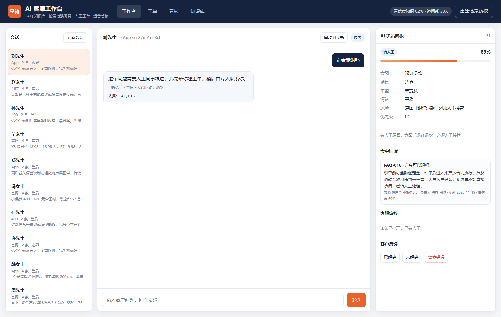
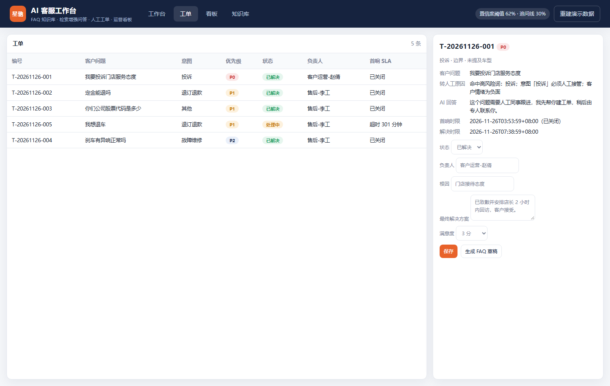
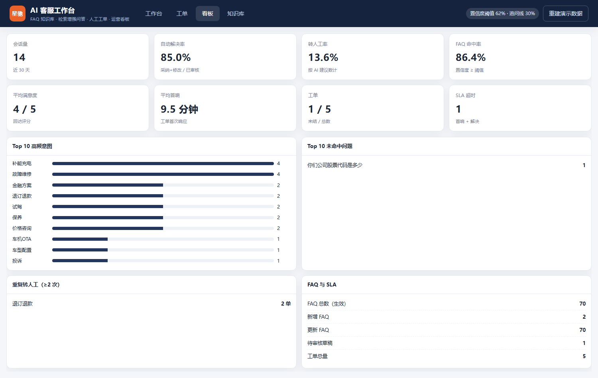
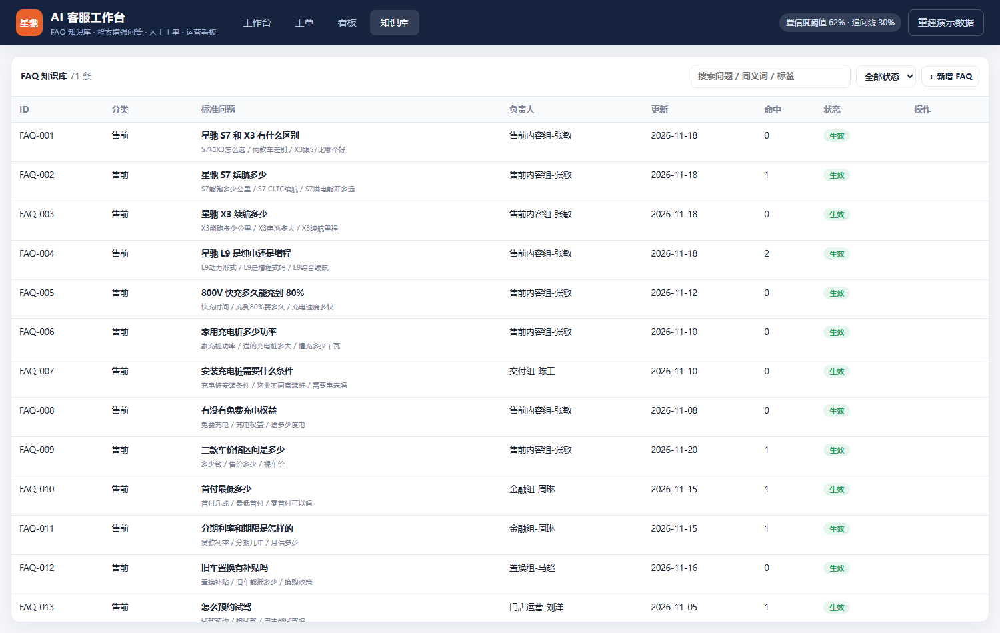
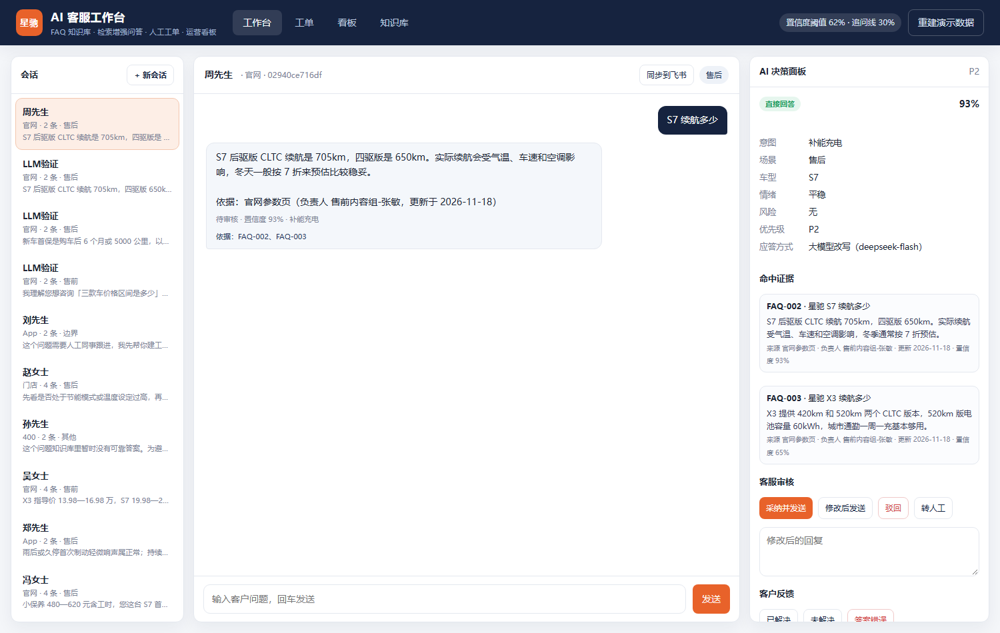

# 星驰汽车 · 4S 店 AI 客服工作台

仓库地址：https://github.com/shechao2/github-notes

面向新能源 4S 店「售前咨询 + 售后维保」场景的 AI 客服演示系统：**结构化 FAQ 知识库 → 检索增强问答 → 置信度分流 → 人工工单与 SLA → 运营看板 → FAQ 回写**，一个本地可跑的完整闭环。

> 品牌「星驰汽车」与车型 X3 / S7 / L9、客户姓名均为虚构，仅用于演示；知识库 69 条 FAQ 为手工整理，内容结构参照真实 4S 店话术，不对应任何真实厂商。

## 界面预览

| 工作台（AI 决策面板 + 审核动作） | 工单（SLA 倒计时 + 处理闭环） |
|---|---|
|  |  |
| **运营看板** | **知识库治理** |
|  |  |

## 一条命令跑起来

```bash
python -m venv .venv
.venv\Scripts\activate           # Windows；macOS/Linux 用 source .venv/bin/activate
pip install -r requirements.txt

python -m app.seed               # 重建演示数据（69 条 FAQ + 14 个会话 + 5 个工单）
python -m app.main               # 或 uvicorn app.main:app --port 8000
```

打开 http://localhost:8000 ，工作台/工单/看板/知识库四个标签页都可操作。

运行测试：

```bash
python -m pytest -q              # 42 passed
```

## 它解决什么问题

4S 店客服每天大量重复回答「S7 续航多少」「首保多久做」「定金能退吗」这类问题。直接丢给大模型有两个坑：**答错价格和保修承诺要担责**，**答不上来时客户直接流失**。这套系统的做法是：

1. 把资料拆成可审核、可追溯的 FAQ 条目（谁写的、依据是什么、什么时候更新）；
2. 检索命中才回答，答案必须带出处；
3. 置信度不够就追问车型和现象，不硬答；
4. 命中不了、客户情绪负面、涉及价格承诺/投诉/退订 → 建工单转人工；
5. 工单解决后把标准答案回写成 FAQ 草稿，审核发布后下次自动命中。

## 简历能力对照

| 简历里写的 | 代码位置 | 现场怎么证明 |
|---|---|---|
| Python、REST API | `app/api.py`（FastAPI 18 个接口）、`app/service.py` | 打开 `/docs` 看 Swagger |
| FAQ 知识库分字段维护 | `data/faq.json`、`app/kb.py` | 知识库页面按分类/负责人/更新时间查看 |
| 同义词、标签、答案来源 | `data/faq.json` 的 `variants/tags/source` 字段 | 搜「维保周期」能命中「保养周期」那条 |
| 问题状态、负责人、优先级、SLA 节点 | `app/tickets.py`、`docs/sla.md` | 工单页看首响倒计时与超时标记 |
| AI 未解决 → 人工接管 → 结果回写 | `app/service.py:review_message`、`app/tickets.py:create_faq_draft` | 转人工 → 填方案 → 生成 FAQ 草稿 → 发布 |
| 看板：解决率、满意度、转人工率、高频问题 | `app/metrics.py` | 看板页 8 个 KPI + 4 张榜 |
| Bad Case 复盘 | 看板「Top 10 未命中」「重复转人工」+ 工单根因 | 演示股票代码那条未命中问题 |

## 五分钟演示路线

1. **看板**：先讲结论——14 个会话、自动解决率 85%、转人工率 13.6%、平均首响 9.5 分钟、满意度 4.0 分。
2. **知识库**：搜「维保周期」，展示同义词命中；搜「多少钱」展示「短问题被压到追问区间」。
3. **工作台**：输入「S7 续航多少」→ 直接回答 + 出处 + 置信度 93%；输入「多少钱」→ 追问车型；输入「给我个底价」→ 直接转人工 P1。
4. **工单**：打开投诉单，看 P0 首响 15 分钟倒计时（演示数据里有一单已超时）；改状态为已解决、填根因和方案。
5. **回写**：点「生成 FAQ 草稿」→ 知识库出现一条待审核 → 发布 → 再搜同样问题就命中了。

详细话术见 `docs/demo-script.md`。

## 目录结构

```
app/
  config.py     阈值、SLA 规则、车型词表（全部可用环境变量覆盖）
  db.py         SQLite 建表与连接（faq / sessions / messages / tickets / events）
  kb.py         FAQ 治理 + FTS5(trigram) 召回 + 覆盖度打分 + 冲突检测
  nlu.py        意图、场景、车型、情绪、风险、信息完整度（可读的规则表）
  answer.py     决策：直接回答 / 追问 / 不猜 / 转人工
  service.py    会话服务：发消息、审核、反馈（API 与演示数据共用）
  tickets.py    工单、SLA 计时、解决闭环、FAQ 回写
  metrics.py    看板指标（全部实时算，不落宽表）
  api.py        REST 接口
  seed.py       演示数据（真实走 service 层，保证数字可解释）
data/faq.json   69 条结构化 FAQ
static/         单页工作台（原生 JS，无构建）
tests/          42 个测试（检索、决策、工单、指标、接口）
docs/           架构、SLA 规则、演示脚本
```

## 飞书多维表格（已打通）

演示表格：**https://my.feishu.cn/base/NNwtbi7R7a5BBlsFWCjc1WaN6ke**（16 个字段，14 条会话已写入）

```bash
python -m app.feishu init     # 建表 + 16 字段（app_token / table_id 自动写回 .env）
python -m app.feishu sync     # 按「会话ID」去重，把本地会话全量同步
```

- 工作台右上角有「同步到飞书」按钮，单个会话一键写入；
- 接口：`GET /api/feishu/status`（是否配置、表地址、字段列表）、`POST /api/feishu/sync?session_id=...`；
- 字段映射：会话ID / 客户昵称 / 性别 / 平台 / 客层 / 咨询意图 / 情绪状态 / 转化状态 / 标签 / 询问商品 / 售价 / 时间 / 问题状态 / 负责人 / 优先级 / SLA节点；
- 凭证只放 `.env`（`FEISHU_APP_ID` / `FEISHU_APP_SECRET`），已被 `.gitignore` 忽略；
- 应用需要开通 **`bitable:app`** 并**发布版本**，否则写入会报 `99991672`。

## 指标口径（面试会被追问，先说清楚）

| 指标 | 公式 |
|---|---|
| FAQ 命中率 | 带证据且置信度 ≥ 阈值的 AI 建议数 ÷ AI 建议总数 |
| 自动解决率 | （采纳 + 修改后发送）÷ 已审核总数（待审核不计） |
| 转人工率 | 转人工建议数 ÷ AI 建议总数 |
| 平均满意度 | 已回访工单评分均值（1—5 分） |
| 平均首响 | 首次响应时间 − 工单创建时间，取均值 |
| Top 10 高频问题 | 用户消息按意图聚合（同义说法归到同一意图） |
| Top 10 未命中 | `status = no_hit` 的问题按出现次数排序 |
| 重复转人工 | 同一意图建单数 ≥ 2 |
| FAQ 新增/更新 | 近 30 天 `created_at` / `updated_at` 计数 |

## 大模型改写（可选）

```bash
# .env
A4S_LLM=1
DEEPSEEK_API_KEY=sk-xxxx
```

开启后：检索照旧，模型只负责把 Top3 证据改写成客服口吻；答案里的**每个数字都必须在证据里出现过**，否则判为「无依据」回退规则拼接；模型输出 `NEED_HANDOFF` 会直接把工单优先级抬高。验证：

```bash
python -m app.llm "S7 续航多少"
```

实测（`deepseek-flash`，单次约 370—420 token，数字全部落在证据内）：



## 兜底规则（写死在代码里，不靠模型自觉）

1. **没检索结果就不生成答案**，直接转人工，不猜。
2. **置信度不足先追问**车型、年份、具体现象，而不是硬答。
3. **价格承诺、投诉、退订、返修纠纷、安全类**一律人工接管（`config.MANDATORY_HANDOFF_INTENTS`、`RISK_KEYWORDS`）。
4. **知识冲突**：高分条目答案不一致时，优先生效且更新时间更近的；分不出就转人工。
5. **阈值可配置**：`A4S_CONF_THRESHOLD`、`A4S_CLARIFY_THRESHOLD`，演示时可现场调。

## 当前限制（M1）与下一步（M2）

- 默认用「检索 + 结构化拼接」生成答案；`.env` 里置 `A4S_LLM=1` 并填 `DEEPSEEK_API_KEY` 后，改由 DeepSeek 依据 Top3 证据重写，数字未在证据中出现会自动回退规则答案（`app/llm.py`）。
- 检索是 FTS5 关键词 + 覆盖度打分，没有向量检索；FAQ 超过几千条时需要上 pgvector/FAISS。
- 工单主存储在 SQLite；飞书多维表格为同步副本（单向写入，暂不回读飞书侧修改）。
- 单机演示，无鉴权；上线需加登录、审计和限流。

## 演示数据说明

- 14 个会话、22 条用户问题、5 个工单，覆盖「直接回答 / 追问 / 未命中 / 投诉转人工 / 客户反馈错误」五种路径；
- 全部走真实 `service.add_turn → review → feedback → ticket` 链路，不是手写死数据；
- 其中 1 单被故意置为超时，用来看 SLA 红色告警；
- 1 条未命中问题（公司股票代码）走到「工单 → 回写 FAQ → 发布」，演示闭环。

重建数据：页面右上角「重建演示数据」，或 `POST /api/demo/seed?reset=true`。
